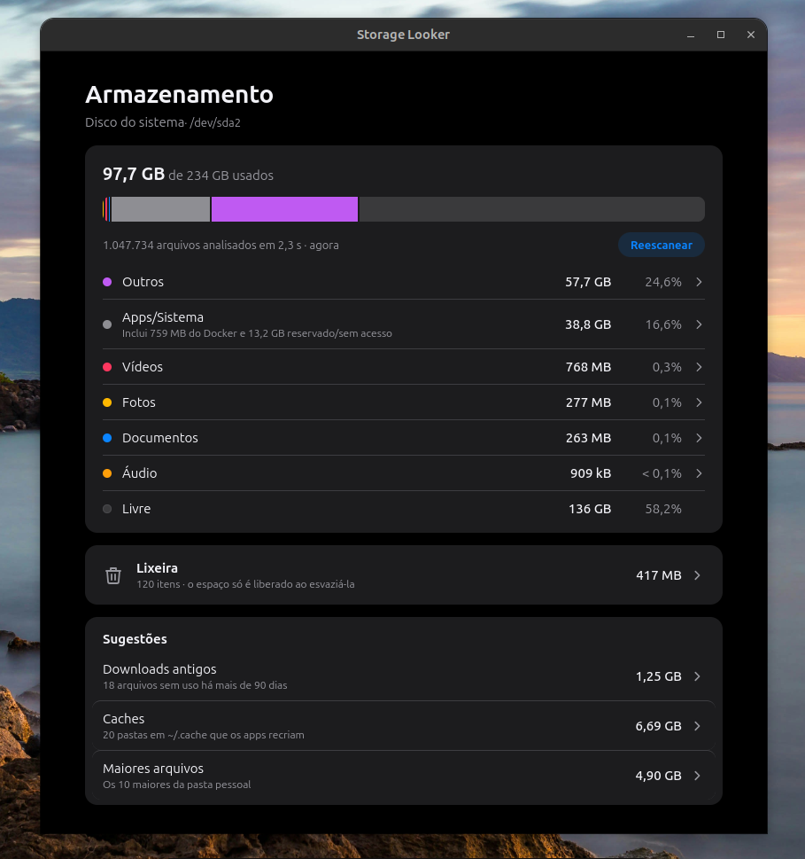
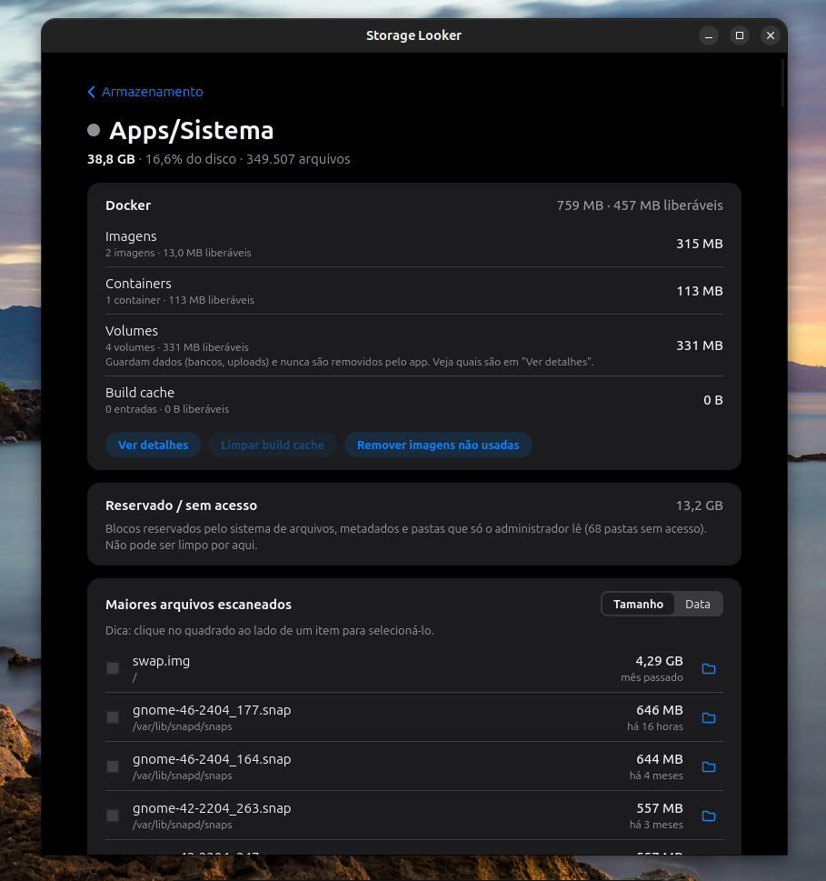
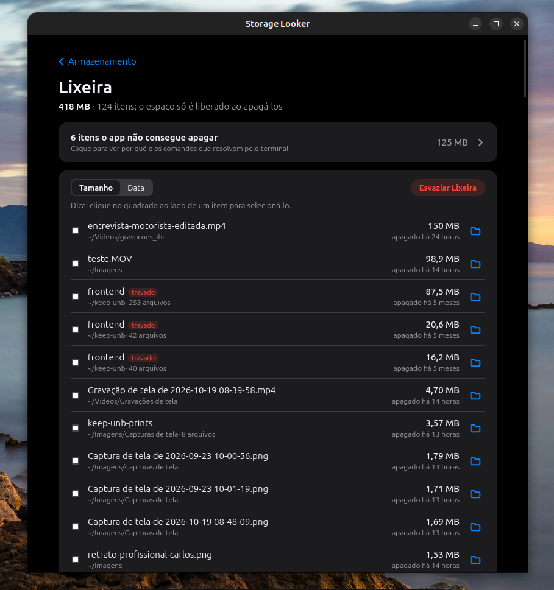

# Storage Looker


Gerenciador de armazenamento para Ubuntu no estilo iOS. Com uma barra horizontal única dividida por cor, com categorias por tipo de arquivo e ações para liberar espaço com segurança.

<p align="center">
  
</p>

**Seu disco inteiro, em uma olhada.** Mais de um milhão de arquivos analisados em pouco mais de 2 segundos, sem pedir senha de administrador. A barra mostra para onde foi cada gigabyte (Fotos, Vídeos, Áudio, Documentos, Apps/Sistema, Outros e espaço livre) e logo abaixo aparecem as sugestões que mais liberam espaço: downloads esquecidos, caches dos apps e os maiores arquivos da sua pasta pessoal.

## Por dentro

<p align="center">
  
</p>

**Nada fica escondido em "Sistema".** Clique em uma categoria para ver o que ocupa espaço de verdade. Em Apps/Sistema, o Docker aparece separado em imagens, containers, volumes e build cache, com quanto dá para liberar em cada um. O espaço que nenhum programa comum consegue ler é mostrado como "reservado / sem acesso", com a explicação do porquê, em vez de sumir da conta.

<p align="center">
  
</p>

**Uma Lixeira que finalmente faz sentido.** Arquivos apagados continuam ocupando disco até a Lixeira ser esvaziada, e o Storage Looker deixa isso claro. Ordene por tamanho ou data, restaure o que foi por engano, apague só o que escolher ou esvazie tudo de uma vez. Itens que o app não consegue remover são marcados como *travados*, com os comandos de terminal que resolvem.

## Recursos

- **Rápido:** escaneia `/` (~1 milhão de arquivos) em cerca de 2 s, com cache quente, sem root.
- **Preciso:** mede o espaço alocado em disco, como `df` e `du`. A barra sempre soma 100% do disco.
- **Classificação inteligente:** o caminho decide antes da extensão. Um ícone em `/usr` é Sistema, um JPG do cache do navegador é Outros e um AppImage é App. Uma foto sem extensão é reconhecida pelo conteúdo.
- **Docker visível:** o espaço de `/var/lib/docker`, que só o root lê, é obtido do próprio Docker (`docker system df`) e aparece como subitem de Apps/Sistema. O Docker rootless (`~/.local/share/docker`) também é reconhecido, sem ser contado duas vezes. "Ver detalhes" lista cada volume, imagem, container e entrada de build cache, com dicas de comandos para liberar espaço.
- **Sugestões de limpeza:** downloads com mais de 90 dias, caches dos apps e os maiores arquivos da pasta pessoal.
- **Lixeira à vista:** um card próprio mostra o que está na Lixeira, com restaurar, apagar só os selecionados ou esvaziar tudo.
- **Seguro:** nada é apagado direto. Os arquivos vão para a Lixeira do Ubuntu, e toda a validação acontece no Rust.

## Stack

Motor em **Rust** (`jwalk`, `statvfs`), janela **Tauri v2** e interface **SvelteKit (Svelte 5) + TypeScript** com CSS puro. A justificativa está em [STACK_CHOICE](docs/STACK_CHOICE.md).

## Instalação (Ubuntu / Debian)

Baixe o pacote `.deb` da versão mais recente na página de [Releases](https://github.com/carloshfgit/storage_LKR/releases/latest) e instale via terminal:

```bash
sudo apt install ./storage-looker_1.0.1_amd64.deb
```

Ou clique duas vezes no arquivo baixado para instalar pela Central de Aplicativos do Ubuntu.

## Desenvolvimento

Para rodar localmente ou compilar a partir do código-fonte:

```bash
npm install
npm run tauri dev          # app em desenvolvimento
cargo test --workspace     # testes
```

O passo a passo completo, com pré-requisitos, a CLI de benchmark, o build do `.deb` e a resolução de problemas, está em **[docs/QUICK_SETUP.md](docs/QUICK_SETUP.md)**.


## Documentação

| Documento | Conteúdo |
|---|---|
| [QUICK_SETUP](docs/QUICK_SETUP.md) | Instalar, rodar, testar, empacotar |
| [PLAN](docs/PLAN.md) | Etapas, critérios de pronto e resultados medidos |
| [ARCHITECTURE](docs/ARCHITECTURE.md) | Como o motor, a ponte e a interface funcionam |
| [DECISIONS](docs/DECISIONS.md) | Cada decisão, com o porquê e o que foi descartado |
| [STACK_CHOICE](docs/STACK_CHOICE.md) | Por que Rust + Tauri + Svelte |

## Autor

Desenvolvido por **Carlos Costa** ([@carloshfgit](https://github.com/carloshfgit)).

## Licença

Este projeto está sob a licença MIT. Consulte o arquivo [LICENSE](LICENSE) para obter mais informações.
